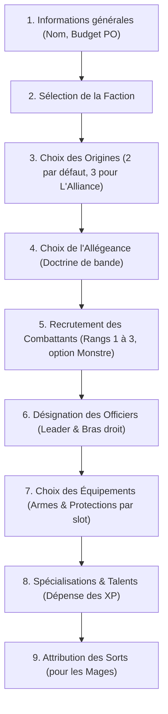

# Règles Métier du Jeu (Synthèse V0.8)

Ce document récapitule les règles de création et de gestion d'une bande extraites des documents de règles V0.8.

---

## 1. Principes Fondamentaux de la Bande

- **Format de table** : 90x90 cm, escarmouche dense en décors et verticalité.
- **Taille de la bande** :
  - **10 combattants maximum** par défaut (mode standard).
  - **15 combattants maximum** pour le format duel (1 vs 1).
- **Budget de recrutement initial** :
  - **10 Pièces d'Or (PO)** par défaut.
  - Le budget doit être **ajustable** pour gérer des formats alternatifs ou l'intégration d'une bande en cours de campagne.
- **Officiers de la bande** :
  - Exactement **1 Leader** : Reçoit 12 XP de base pour ses Spécialisations / Talents.
  - Exactement **1 Bras droit** : Reçoit 6 XP de base pour ses Spécialisations / Talents.
  - Le Rang du combattant désigné n'a pas d'importance (un combattant de Rang 1, 2 ou 3 peut être désigné).
  - Un **Animal** ne peut jamais être Officier.
  - Un **Monstre** ne peut pas être Officier, sauf exception de faction (ex. faction *La Monstruosité*).

---

## 2. Arborescence et Ordre de Création

Pour créer une bande de manière cohérente, le processus suit l'ordre logique suivant :

---

## 3. Factions & Origines

Le jeu propose plusieurs factions majeures avec leurs propres profils de caractéristiques par Rang :
- **L'Alliance** (Humains) : Règle *Polyvalents* (sélection de 3 origines au lieu de 2).
- **L'Excellence** (Elfes, Elfes noirs, Sylvains) : Règles *Clairvoyants* (+1 initiative) et *Réflexes surhumains* (pas d'armure/bouclier mais +1 esquive CàC).
- **La Perfidie** (Gobelins, Skaven) : Règles *Insaisissables* (Agile et Discret si sans armure/bouclier).
- **La Brutalité** (Orcs, Hommes-bêtes, Lézards) : Règle *Fureur* (+1 dé CàC si blessé).
- **L'Éternité** (Morts-vivants) : Caractéristiques et règles spécifiques mort-vivant.
- **La Ténacité** (Nains, Nains du chaos) : Profils robustes.
- **Les Mercenaires** (Chasseurs de primes, Pirates, Renégats) : Règles d'adaptation.
- **La Monstruosité** (Ogres, Trolls) : Autorise des particularités sur les grands combattants et monstres.

Chaque faction dispose d'un panel d'**Origines** (ex: *Cité développée, Académie militaire, Célestes, Ombres des bois, etc.*) accordant des bonus thématiques ou modifiant les accès d'équipements/règles.

---

## 4. Allégeances

L'Allégeance est une doctrine globale choisie pour la bande. Elle applique un modificateur passif ou une capacité utilisable en partie :
- *Corps d'armée (Phalange)* : +1 défense CàC au contact d'au moins 2 alliés, immunité au recul.
- *Explorateurs (Grimpeurs, Pas assurés)* : Ignore malus terrain difficile, Agile si non armuré.
- *Fanatiques (Frénésie)* : Immunité Terreur, +1 Mouvement, pas d'armure/bouclier.
- *Conclave des Mages* : Officiers avec sort reçoivent *Incantation maîtrisée* gratuite ; 2ème spécialisation de Mage sans surcoût.
- *Ordre du Temple (Don des Dieux, Protection divine)* : Bonus aléatoire sur 1d6 avant la 1ère spé ; relance d'un jet de défense / tour.
- *Guilde des Ombres (Plan secret, Infiltration)* : Priorité de tour 1x/partie ; déplacement pré-partie pour 3 combattants.
- *Chasseurs (Tir ajusté, Lames affûtées)* : Ignore malus de tir après mouvement ; règle *Acérée* sur CàC.
- *Union des peuples (Collaboration)* : Permet de recruter des combattants d'une autre faction alliée.
- *Brigands (Embuscade, Coups bas)* : Activation réactive sur mouvement ennemi ; règle *Sadique*.

---

## 5. Recrutement des Combattants

### Types de Combattants
1. **Infanterie (Par défaut)** :
   - **Rang 1** : Coût 1 PO.
   - **Rang 2** : Coût 2 PO.
   - **Rang 3** : Coût 3 PO.
2. **Monstre (Rang 4)** :
   - Coût : **4 PO**.
   - Maximum **1 Monstre** par bande.
   - Profil au choix : *Le Tank*, *La Brute*, *Le Prédateur*.
   - Voie de la Bête uniquement, équipement lourd spécifique.
   - Ne peut pas être Officier (sauf faction *La Monstruosité*).
3. **Animal** :
   - Jusqu'à **2 combattants** d'Infanterie peuvent convertir leur type en Animal.
   - Équipé de 2 armes de pugilat, ne peut pas porter d'armure, de bouclier ni de trésor.
   - Ne bénéficie pas des règles de faction/origines (sauf mention explicite).
   - Ne peut pas être Officier ni choisir de Spécialisation.
   - Choix d'un bonus d'espèce (+2 Mouvement, +1 Mvt & +1 Prot, Vol/bond, ou Bonus de charge).

---

## 6. Équipements & Emplacements (Slots)

### Capacité d'emport (Emplacements)
- **Rang 1 et Rang 2** : **2 emplacements**.
- **Rang 3** : **3 emplacements**.
- **Monstre (Rang 4)** : **4 emplacements**.

### Restrictions & Coûts
- **Niveau de l'équipement** : Un combattant ne peut équiper que des armes et armures dont le Niveau est **inférieur ou égal à son Rang** (Niveau 1, 2 ou 3).
- **Coût à la création** :
  - Armes et Protections classiques : **0 PO** (gratuites, régies uniquement par les emplacements et le Rang).
  - Objets magiques & Consommables : Coûtent généralement **1 PO** (normalement acquis en cours de campagne ou loot, mais option activable pour intégration en cours de partie).

### Catégories d'équipements
1. **Armes de Corps à Corps** :
   - *1 main (1 slot)* : Armes légères, Pugilat, Armes intermédiaires, Armes lourdes.
   - *2 mains (2 slots)* : Armes légères, Armes intermédiaires, Armes lourdes.
   - Règle d'arme supplémentaire : une seconde arme identique à 1 main accorde +1 dé d'attaque ; à 2 mains accorde +2 dés.
2. **Armes de Tir** :
   - *1 main (1 slot)* : Armes de jet (portée = valeur de Combat), Armes de poing.
   - *2 mains (2 slots)* : Arcs, Arbalètes / Arquebuses.
3. **Protections** :
   - *Boucliers* : Niveau 1 (1 slot, +1 Prot), Niveau 3 (2 slots, +2 Prot, Encombrant).
   - *Armures* : Niveau 1 (+1 Prot), Niveau 2 (+2 Prot, -1 Esquive), Niveau 3 (+3 Prot, -1 Esquive, -1 Mouvement, Encombrant).

---

## 7. Spécialisations, Talents & Sorts (XP)

- **Budget XP de départ** :
  - Leader : **12 XP**
  - Bras droit : **6 XP**
  - Autres combattants : 0 XP (possibilité de recruter des vétérans en dépensant 1 PO pour 6 XP).
- **Coûts en XP** :
  - **6 XP** pour débloquer une Spécialisation (ex: *Guerrier, Mage, Tireur, etc.*).
  - **6 XP** par Talent rattaché à une Spécialisation déjà acquise.
  - **Pénalité de redondance** : Chaque spécialisation coûte **+6 XP supplémentaires** pour chaque autre combattant de la bande qui la possède déjà.
- **Sorts (pour les Mages)** :
  - Un Mage sélectionne des sorts dans le *Livre des sorts*.
  - Le cumul des niveaux des sorts ne peut pas dépasser son Rang (hors talents augmentant cette limite).
