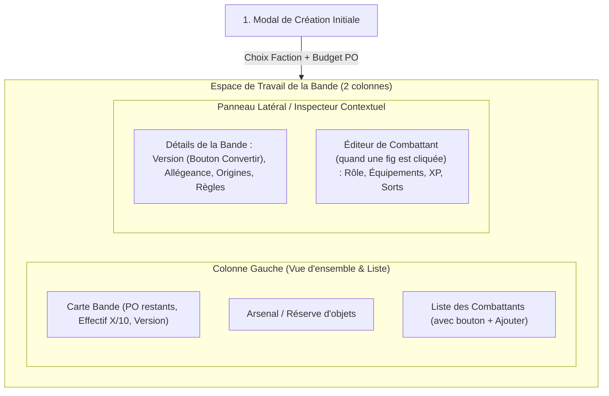

# Spécifications Fonctionnelles de l'Application

Ce document définit les exigences fonctionnelles, les parcours utilisateurs et le moteur de validation de l'application de création de bande.

---

## 1. Objectifs & Rôles Utilisateurs

L'application s'adresse principalement aux joueurs sur table et aux créateurs de contenu :
- **Joueur sur table** : Veut concevoir une bande rapidement sans erreur de calcul (coûts PO, slots, malus d'armures, XP des spécialisations), l'exporter ou l'utiliser directement sur son smartphone/tablette pendant la partie.
- **Maître de jeu / Joueur en campagne** : Veut faire vivre sa bande au fil des affrontements (blessures, trésorerie, passage de rang, nouveaux équipements).
- **Auteur du jeu (Game Designer)** : Veut tester des modifications d'équilibrage (nouveaux coûts, profils ajustés) via un fichier de règles versionné sans devoir modifier le code source.

---

## 2. Parcours Utilisateur & Ergonomie (Inspiration Trench-Companion)

L'interface adopte une ergonomie inspirée des meilleurs outils du genre (ex: *Trench-Companion*) avec une disposition en **Panneau Principal / Inspecteur Latéral (Master-Detail)** :

### 2.1. Initialisation de la Bande (Modal d'entrée)
À la création, l'utilisateur ne renseigne que deux éléments indispensables :
1. **La Faction** : Cœur identitaire du catalogue de règles, seul élément verrouillé après création.
2. **Le Budget en PO** : 10 PO proposé par défaut (ajustable immédiatement).

### 2.2. Vue Principale & Flexibilité Totale
Une fois validé, le joueur arrive sur la fiche complète de la bande :
- **Tout reste modifiable à tout moment** (sauf la Faction) : Nom de la bande, Allégeance, Origines, ajouts/retraits de combattants, équipements, budget PO.
- **Accès aux Objets Magiques / Consommables** :
  - Ces objets sont masqués ou signalés comme non autorisés à la création par défaut.
  - Le joueur peut les débloquer via une confirmation explicite :  
    > *"Ces objets sont normalement inaccessibles à la création d'une bande, êtes-vous sûr de vouloir activer ces objets ?"*
- **Effectif de la Bande** :
  - **1 combattant = 1 place dans la bande**, quel que soit son Rang.
  - La jauge d'effectif affiche simplement : $\text{Nombre de combattants} / 10$ (ou $/ 15$ en duel). Le Rang influence le coût en PO et les stats, mais pas le nombre de places occupées dans la liste.

---

## 3. Gestion des Versions de Règles & Migration

### 3.1. Version "Live" vs Versions Archivées
- Le système dispose d'une version désignée comme **"Live"** par l'administrateur (ex: `V0.8` actuellement, puis `V0.9`).
- Toute nouvelle création de bande s'effectue automatiquement sur la version **Live**.
- Si une bande utilise une version antérieure (ex: créée en V0.8 alors que la V0.9 est Live) :
  - Un badge visuel distinctif l'indique clairement (ex: `Version 0.8 (Archivée)`).
  - Un bouton d'action directe **« Convertir vers la version Live »** (ou autre version) est accessible dans le panneau de détails.

### 3.2. Migration en un Clic avec Double-Check
- Lorsqu'un joueur clique sur « Convertir de version » :
  - Une modale de **double confirmation** récapitule les impacts potentiels (éventuels changements de coûts, règles modifiées).
  - La conversion s'effectue proprement en conservant les sélections compatibles et en signalant les ajustements nécessaires via le moteur de validation.

---

## 4. Moteur de Règles & Validation (Rules Engine)

Le moteur de validation s'exécute en temps réel (côté client pour la réactivité, et validé côté API à la sauvegarde) :

| Règle de validation | Type | Condition de blocage / alerte |
| :--- | :---: | :--- |
| **Dépassement de budget PO** | Erreur | $\sum \text{Coût PO} > \text{Budget Max}$ |
| **Limite de combattants** | Erreur | Nombre de figurines $> 10$ (ou $> 15$ si format duel) |
| **Officier Leader manquant/dupliqué** | Erreur | $\text{Nombre de Leader} \ne 1$ |
| **Officier Bras droit manquant/dupliqué** | Erreur | $\text{Nombre de Bras droit} \ne 1$ |
| **Limite de Monstres** | Erreur | Plus de 1 Monstre par bande |
| **Limite d'Animaux** | Erreur | Plus de 2 Animaux par bande |
| **Capacité d'emplacements (Slots)** | Erreur | Emplacements occupés $>$ Emplacements max de la figurine |
| **Niveau d'équipement trop élevé** | Erreur | Niveau arme/armure $>$ Rang du combattant (hors règle dérogatoire) |
| **Dépassement de budget XP** | Erreur | XP alloués $>$ XP max accordés au combattant |
| **Dépassement niveau de sorts** | Erreur | Somme des niveaux de sorts $>$ Rang du Mage |

---

## 5. Mode Campagne (Spécificités)

En cochant l'option **Mode Campagne**, la bande active des fonctionnalités étendues :
1. **Trésorerie persistante** :
   - Historique des gains de PO et d'objets après chaque partie.
   - Coffre de bande (*Stash*) pour stocker les armes, armures et objets non équipés.
2. **Gestion des blessures après-partie** :
   - Enregistrement des résultats du tableau de blessures (mort permanente, perte d'un bras entraînant $-1$ slot d'équipement, malus de stats).
   - Option Dispensaire (1 PO) pour fiabiliser le jet de survie.
3. **Progression des combattants** :
   - Dépense de PO pour monter de Rang (ex: Rang 1 vers Rang 2 pour 1 PO).
   - Achat d'XP d'entraînement (1 PO pour 6 XP).
   - Historique des parties jouées et statistiques de victoires.

---

## 6. Exportation & Affichage sur Table

- **Feuille de bande imprimable (Print-friendly / PDF)** :
  - Vue synthétique de la bande sur 1 page A4 (nom, faction, trésor, règles globales).
  - Fiches individuelles compactes par combattant sous forme de cartes d'action (profil, armes avec portées/puissances, règles spéciales associées).
- **Mode de Jeu Mobile / Tablette** :
  - Interface plein écran adaptée aux écrans tactiles pendant la partie.
  - Suivi interactif des Points de Vie (compteur PV restant pour chaque combattant).
  - Popovers / infobulles sur chaque règle spéciale pour consultation instantanée des textes officiels sans ouvrir le PDF.
