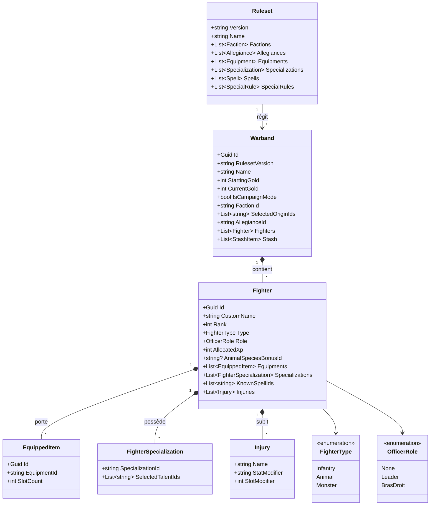

# Modèle Conceptuel de Données (MCD Métier)

Ce document formalise les entités du domaine métier et leurs relations, afin de servir de base à l'implémentation du Backend C# et de l'état frontend Vue.js.

---

## 1. Vue d'Ensemble des Entités

Le modèle distingue deux grands domaines :
1. **Les Données de Règles (`Ruleset`)** : Immuables pour une version donnée (ex. V0.8). Contient le catalogue du jeu (Factions, Profils, Allégeances, Armes, Sorts, etc.).
2. **Les Données Utilisateur (`Warband`)** : Dynamiques. Représente l'état et les choix d'un joueur.

---

## 2. Description Détaillée des Entités Utilisateur

### 2.1. `Warband` (La Bande)
- `Id` : Identifiant unique (UUID).
- `RulesetVersion` : Chaîne de version (ex: `"0.8"`). Garantit que la bande fait référence au jeu de règles exact sous lequel elle a été créée.
- `Name` : Nom donné par le joueur.
- `FactionId` : Référence vers la Faction choisie.
- `SelectedOriginIds` : Liste des identifiants des Origines sélectionnées (ex: 2 pour la plupart, 3 pour l'Alliance).
- `AllegianceId` : Référence vers l'Allégeance choisie.
- `StartingGold` : Budget initial alloué (par défaut 10).
- `CurrentGold` : Trésor disponible en PO (particulièrement utile en campagne).
- `IsCampaignMode` : Booléen déterminant si les fonctionnalités avancées de campagne sont actives.
- `Fighters` : Liste des combattants recrutés.
- `Stash` : Liste d'objets ou équipements stockés dans la réserve de bande (mode campagne).

### 2.2. `Fighter` (Le Combattant)
- `Id` : Identifiant unique de la figurine dans la bande.
- `CustomName` : Nom personnalisé donné par le joueur (ex: *"Grimgor", "Garde 1"*).
- `Rank` : Entier de 1 à 4 (1 = Recrue, 2 = Guerrier, 3 = Élite/Vétéran, 4 = Monstre).
- `Type` : Énumération (`Infantry`, `Animal`, `Monster`).
- `Role` : Énumération (`None`, `Leader`, `BrasDroit`).
- `AllocatedXp` : XP totaux investis sur ce combattant (par défaut 12 si Leader, 6 si Bras droit, 0 sinon).
- `AnimalSpeciesBonusId` : Identifiant du bonus d'espèce sélectionné si `Type == Animal`.
- `Equipments` : Liste des armes, armures et protections équipées.
- `Specializations` : Spécialisations et talents débloqués.
- `KnownSpellIds` : Sorts connus (pour les Mages).
- `Injuries` : Blessures et séquelles permanentes (mode campagne).

---

## 3. Entités du Catalogue de Règles (`Ruleset`)

Chaque version de règles est représentée par un document structuré et indépendant :
- **`Faction`** :
  - `Id`, `Name`, `Description`, `SpecialRule`.
  - Profils de stats de base par Rang : `RankProfiles: { 1: Stats, 2: Stats, 3: Stats }`.
  - Liste d'**`Origin`** propres à cette faction.
  - Exceptions de faction (ex. monstre autorisé en Officier, slots supplémentaires, etc.).
- **`Allegiance`** :
  - `Id`, `Name`, `Description`, `Rules` (modificateurs passifs ou capacités déclenchées).
- **`Equipment`** :
  - `Id`, `Name`, `Category` (CàC, Tir, Protection, Consommable, Objet Magique).
  - `SubCategory` (Légère, Intermédiaire, Lourde, Bouclier, Armure, etc.).
  - `Level` (1, 2 ou 3).
  - `HandsRequired` / `SlotsRequired` (1 ou 2).
  - Caractéristiques offensives/défensives : `Puissance`, `Précision`, `Portee`, `Protection`.
  - `SpecialRuleIds` (ex: *Acérée, Parade, Allonge, Perce-armure, Encombrant, Rechargement*).
  - `CostInGold` (0 pour armes classiques, $\ge 1$ pour objets spéciaux).
- **`Specialization` & `Talent`** :
  - `Id`, `Name`, `Description`, `Category` (Guerrier, Mage, Tireur...).
  - `Talents` : Liste des talents sélectionnables une fois la spécialisation acquise.
- **`Spell`** :
  - `Id`, `Name`, `Level` (1, 2, 3...), `Description`, `CostInVolonte`.
- **`SpecialRule`** :
  - `Id`, `Name`, `Description` (Glossaire complet pour affichage infobulle).
