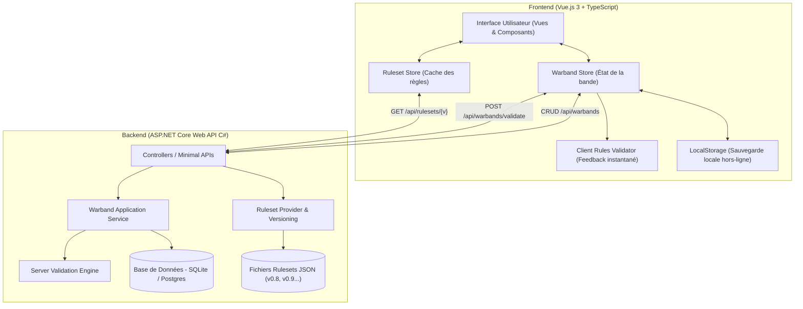

# Architecture Technique Globale

Ce document détaille l'architecture technique du projet, les choix technologiques et les flux d'échanges entre le Frontend Vue.js et le Backend C#.

---

## 1. Stack Technologique Retenue

- **Backend** : **C# (.NET 10 / `net10.0`)**
  - **Architecture en couches / Clean Architecture** (alignée sur les standards du projet `ctr-roster`) :
    - `CtrWargameBuilder.Domain` : Entités métier, agrégats (Bande, Combattant, Profil, Équipement), interfaces des repositories et règles pures.
    - `CtrWargameBuilder.Application` : Cas d'utilisation (Use Cases / Handlers), validation métier (*FluentValidation*), DTOs et mapping.
    - `CtrWargameBuilder.Infrastructure` : Accès aux données avec **Entity Framework Core 10** et **SQLite** (`Microsoft.EntityFrameworkCore.Sqlite`), chargement des Rulesets JSON, implémentations d'authentification et hashing.
    - `CtrWargameBuilder.Presentation` (ou `Api`) : ASP.NET Core Web API (Controllers / Minimal APIs), middlewares d'authentification JWT/Cookies, configuration CORS et documentation OpenAPI/Scalar.
  - **Persistance & Données** :
    - Base de données légère : **SQLite** via EF Core (fichier local, zéro configuration serveur, migration automatique).
    - Système de règles : Fichiers JSON versionnés (`rulesets/v0.8/`, etc.) chargés en mémoire et mis en cache.
  - **Tests Unitaires & d'Intégration** (stack identique à `ctr-roster`) :
    - **xUnit** (2.9.x)
    - **Microsoft.NET.Test.Sdk**
    - **Testcontainers** (pour tests d'intégration avec environnement isolé)
    - **coverlet.collector** pour la couverture de code.

- **Frontend** : **Vue.js 3**
  - Langage : **TypeScript**
  - Framework réactif : Composition API avec `<script setup>`
  - Gestion d'état : **Pinia** (`rulesetStore`, `warbandStore`, `authStore`)
  - Routage : **Vue Router**
  - Styles : **Tailwind CSS** (design moderne, responsive mobile & tablette)
  - Icônes : **Lucide-vue-next**
  - Rendu d'impression : Feuilles de styles `@media print` dédiées (cartes de combattants et récapitulatif A4).

---

## 2. Authentification, Rôles et Persistance des Données

### 2.1. Persistance Hybride (Local-First + Cloud Sync)
- **Mode Anonyme / Invité (Local-First)** :
  - Tout utilisateur peut créer, modifier et tester des bandes immédiatement sans obligation de créer un compte.
  - Les bandes sont conservées dans le navigateur (`LocalStorage` / `IndexedDB`).
  - Export / Import manuel en `.json` possible à tout moment.
- **Mode Connecté (Cloud Sync)** :
  - Dès qu'un utilisateur se connecte, ses bandes locales peuvent être importées / synchronisées avec la base SQLite du serveur.
  - Les bandes sont accessibles depuis n'importe quel appareil.
  - Possibilité de générer un **lien de partage public** (lecture seule) pour envoyer sa liste à un adversaire ou sur Discord.

### 2.2. Mécanisme d'Authentification
Pour garantir la souveraineté des utilisateurs tout en offrant de la flexibilité :
1. **Compte Local Natif (Par défaut)** : Inscription par **Email + Mot de passe fort** (hachage sécurisé BCrypt/Argon2), génération de tokens JWT (ou cookies HTTP-only sécurisés).
2. **Authentification Tierce Optionnelle (OAuth2)** : Connexion en un clic (ex. Discord OAuth2) pour les utilisateurs qui le souhaitent.

### 2.3. Gestion des Rôles (RBAC)
- **Rôle `User`** :
  - Crée, modifie, supprime, duplique ses propres bandes.
  - Génère des liens de partage publics.
- **Rôle `Admin` / `GameDesigner`** :
  - Définit quelle version de règles est la version **"Live"** active.
  - Peut téléverser ou recharger de nouveaux packs de règles JSON (V0.8, V0.9...) sans redémarrer le serveur.

---

## 3. Stratégie d'Exécution et Réactivité

### 3.1. Validation Double Niveau
1. **Niveau 1 : Frontend (Instantané)**
   - Le catalogue de règles de la version sélectionnée est chargé une seule fois par le frontend et conservé dans `rulesetStore`.
   - À chaque modification (ajout d'une arme, changement d'un rôle, dépense d'XP), un moteur de calcul léger côté Vue réévalue :
     - Les totaux de PO et d'XP.
     - Les emplacements occupés vs disponibles.
     - Les alertes visuelles (ex. surbrillance rouge si un slot déborde).
2. **Niveau 2 : Backend (Autoritaire)**
   - Lors de la sauvegarde ou de l'export d'une bande, le backend C# revalide l'intégralité du modèle contre le ruleset versionné officiel.
   - Empêche toute corruption ou contournement de règles.

### 3.2. Fonctionnement Hors-Ligne & Sauvegarde Locale
- Grâce au stockage du Ruleset côté client et à l'usage de `localStorage`, un joueur peut continuer à modifier sa bande même avec une mauvaise connexion dans une salle de jeu ou convention.
- Possibilité d'exporter et importer directement un fichier `.json` de bande sur sa machine sans dépendre obligatoirement d'un compte utilisateur en ligne.
